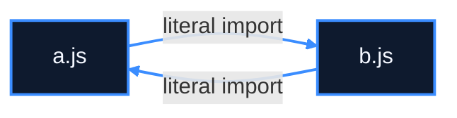
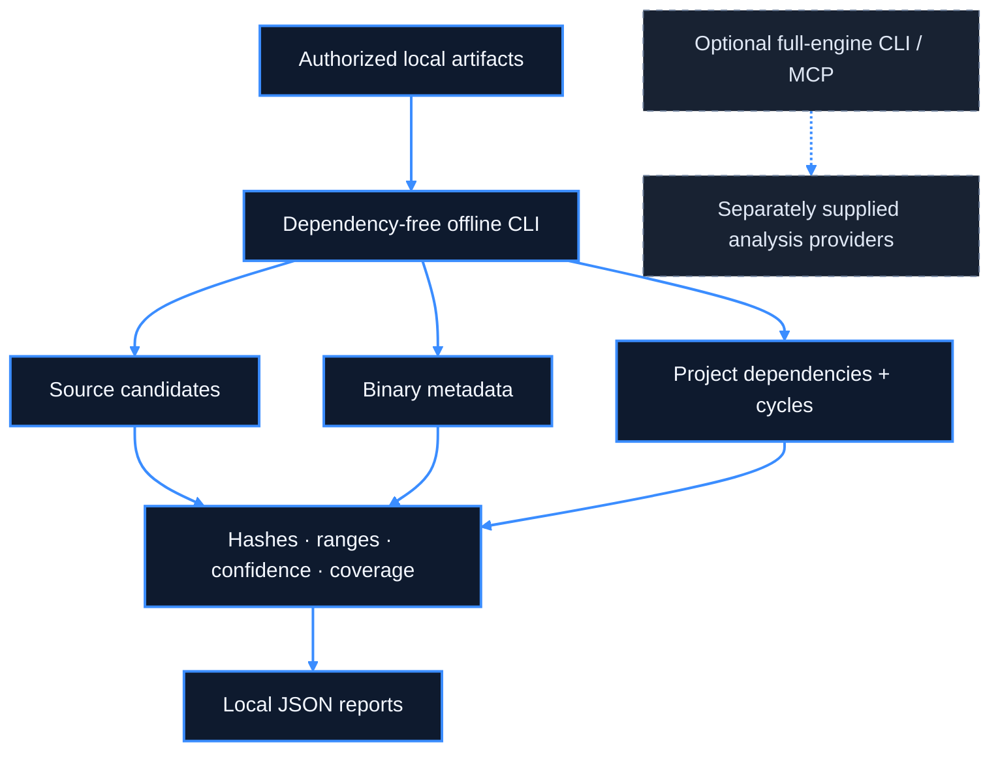

<picture>
  <source media="(max-width: 600px) and (prefers-color-scheme: dark)" srcset="assets/brand/hero-mobile-dark.svg">
  <source media="(max-width: 600px)" srcset="assets/brand/hero-mobile-light.svg">
  <source media="(prefers-color-scheme: dark)" srcset="assets/brand/hero-dark.svg">
  
</picture>

<h1 align="center">NEXORA ENGINE</h1>

<p align="center"><strong>Understand source, inspect binaries, and map architecture—with evidence you can trace.</strong></p>

<p align="center">
  <a href="#status-and-scope"></a>
  <a href="LICENSE"></a>
  <a href="#first-run"></a>
</p>

<p align="center">
  <a href="#first-run">First run</a> ·
  <a href="#capabilities">Capabilities</a> ·
  <a href="docs/start-here.md">Documentation</a> ·
  <a href="#mcp-and-the-full-engine">MCP</a> ·
  <a href="docs/nexora-roadmap.md">Roadmap</a> ·
  <a href="CONTRIBUTING.md">Contribute</a>
</p>

## First run

**Clone → analyze → inspect.** Use Node.js `24.22.1` (the repository pin), or another version accepted by [package.json](package.json). The offline CLI needs no dependency installation and no build.

```sh
git clone https://github.com/NADER-CY/nexora-engine.git
cd nexora-engine
node nexora/bin/nexora.mjs analyze-project examples/tutorial/cycle
```

The included two-file sample imports in both directions. The command returns a JSON report containing this actual cycle result (selected fields):

```json
{
  "architecture": {
    "schema": "nexora-architecture/v1",
    "cycles": [
      {
        "members": ["a.js", "b.js"],
        "kind": "strongly-connected-dependency-candidates"
      }
    ]
  }
}
```



This diagram represents the included sample's static dependency candidates—not observed runtime traffic. [See the complete recorded output](docs/demos/cycle.json) and [learn to read its evidence](docs/tutorials/README.md#evidence-and-confidence).

**Next:** [Windows](docs/installation/windows.md) · [Linux](docs/installation/linux.md) · [macOS](docs/installation/macos.md) · [Full source installation](docs/installation/from-source.md)

## Capabilities

NEXORA ENGINE is a local analysis toolkit for developers exploring codebases and executable artifacts. Its dependency-free CLI produces source candidates, binary metadata, dependency maps and evidence-bearing reports. A separate, provider-backed engine offers CLI/MCP workflows when its dependencies and tools are available.

| Analyze | What you receive on `main` | Practical limit |
|:--|:--|:--|
| **Source** | Lexical function, call and dependency candidates for JavaScript, TypeScript, Go, Rust, C and C++. | Not compiler scope/type resolution. |
| **Binaries** | ELF32/64, PE32/PE32+ and thin Mach-O32/64 sections, symbols, imports/exports and dependencies. | Metadata inspection; no offline instruction disassembly or CFG. |
| **Architecture** | Relative dependency candidates, incoming/outgoing file degrees and dependency cycles. | Cross-file semantic calls and package-manager resolution remain unresolved. |
| **Evidence** | Input SHA-256, byte ranges, confidence, effective limits and omission counters. | Incomplete coverage cannot prove a finding is absent. |
| **Ghidra reports** | Structured import of supplied JSONL functions, pseudocode and references. | Real exporter/decompiler execution is unverified here. |
| **Large inputs** | Chunked reads, bounded inventories, cooperative deadlines/cancellation and failure isolation. | Not hard OS resource isolation. |

Also included: bundle literal scanning, supplied-session summaries, ZIP-entry safety checks and lifecycle-script auditing. The preserved full engine has richer upstream providers with separate requirements. [Detailed command contracts](PHASE3A.md).

## See the evidence

### A source file

```sh
node nexora/bin/nexora.mjs analyze-source examples/tutorial/project/main.js
```

The report identifies `format` and `start`, and records the `format()` call as a `unique-name-candidate`. The file's SHA-256 and call-site byte range let you return to the original bytes. [Recorded source output](docs/demos/source.json) · [Source tutorial](docs/tutorials/README.md#first-source-file).

### A real binary

With an existing reviewed MinGW GCC toolchain on Windows, compile the included non-sensitive sample; there is no need to run it:

```powershell
gcc -shared .\examples\tutorial\sample.c -o "$env:TEMP\nexora-example.dll"
node .\nexora\bin\nexora.mjs analyze-binary "$env:TEMP\nexora-example.dll"
```

Our recorded run returned PE / 64-bit metadata and the exported symbol `nexora_example`. [Actual result summary](docs/demos/binary-summary.json) · [Compiler and run provenance](docs/demos/provenance.json). Build hashes can differ by toolchain. ELF and Mach-O inspection examples are in [the binary tutorial](docs/tutorials/README.md#pe-elf-and-mach-o); their platform compile commands were not executed in this Windows check.

### A whole project

```sh
node nexora/bin/nexora.mjs analyze-project examples/tutorial/project
```

This sample yields a dependency from `main.js` to `worker.js`. [Recorded project output](docs/demos/project.json). Every demonstrated command above uses this PR's unchanged `main` engine—not unpublished analysis code.

## How it fits together



The offline layer lives under `nexora/`; the full engine retains its layered domain/workflow/provider design. [Architecture contracts](docs/architecture/README.md) · [Detailed upstream layer map](docs/architecture.mermaid).

## MCP and the full engine

The offline CLI and the MCP server are different installation paths. After reviewing prerequisites, the full engine's documented source workflow is:

```sh
npm ci --ignore-scripts
npm run build
node scripts/rea.mjs mcp
```

**Optional and not end-to-end verified in this documentation check.** The full engine needs its locked dependencies, compiled runtime and any selected external providers. Skipping lifecycle scripts can leave optional native tools unavailable. Do not enable every install script to work around an error.

Configure a client using the **absolute local Node/launcher path**, never an unpublished `npx` package. [MCP overview](docs/mcp/README.md) · [Codex](docs/mcp/codex.md) · [Claude](docs/mcp/claude.md) · [Generic stdio clients](docs/mcp/generic-client.md).

<details>
<summary><strong>Advanced setup, Ghidra and troubleshooting</strong></summary>

- Node ranges: `^22.23.4 || ^24.22.1 || >=26.12.1`; npm pin: `11.16.0`. Check [package.json](package.json) for the current source of truth.
- Use the [from-source guide](docs/installation/from-source.md); the inherited `install.sh` installs upstream REA, not NEXORA ENGINE.
- Ghidra and its compatible JDK are bring-your-own. [Exporter/importer workflow](docs/tutorials/ghidra.md). The included [JSONL sample](examples/tutorial/ghidra.synthetic.jsonl) is explicitly synthetic; it does not demonstrate a real decompiler run.
- Missing `dist/` means the full engine has not been built. It does not prevent offline commands.
- For MCP problems, separate configuration, process startup, initialization, tool discovery and invocation. Windows JSON paths require escaped backslashes.
- Optional native bridges have separate platform/toolchain requirements: [Windows addon](native/windows/README.md). Installation guides are available for all three desktop platforms; this documentation verification ran on Windows.
- [Verification record](docs/github-experience-verification.md) and [publication review](PUBLICATION_REVIEW.md) describe actual checks and gaps.

</details>

## Status and scope

**Development source, not a production certification.** No official npm package or prebuilt NEXORA ENGINE release is offered here. NEXORA ENGINE is an MIT-licensed derivative of [REA by morluto](https://github.com/morluto/rea); its original engine and attribution are preserved.

| Available on `main` | Proposed in [draft PR #1](https://github.com/NADER-CY/nexora-engine/pull/1) |
|:--|:--|
| Six-language lexical source candidates, binary metadata, file dependency cycles and Ghidra JSONL ingestion. | Opt-in JS/TS AST scopes and direct ESM call candidates; richer relocations and Ghidra binary-identity matching; unified JSON/Mermaid graph commands and supported route/event/configuration candidates. |

**PR #1 is not merged or released.** Its implementation and test results must not be read as verification of `main`. This documentation PR reuses its already-written guides and samples without taking engine changes. Our diagram above is an authored diagram of the included sample; `main` does not expose the new architecture/Mermaid export command.

Remaining work includes real Ghidra verification, native instruction-level CFG integration and deeper compiler semantics. No performance claims, hosted service, official npm package or prebuilt NEXORA ENGINE release are implied. [Roadmap](docs/nexora-roadmap.md) · [Branch dependency notes](docs/github-experience-verification.md#branch-boundaries).

## Security and privacy

Inspect only artifacts you are authorized to analyze. Offline reports can contain source, symbols, paths and decompiled material; keep them private unless intentionally sanitized. Cooperative limits are not a substitute for isolating hostile inputs. Full-engine providers may launch tools or access caller-selected resources—review the selected workflow's authority.

[Security policy](SECURITY.md) · [Public-source review](PUBLICATION_REVIEW.md) · [Disclaimer](DISCLAIMER.md). npm remains private and automatic publishing/deployment workflows remain disabled.

## Contribute

Useful contributions include minimal parser regressions, reproducible toolchain cases, clearer uncertainty reporting and platform verification. Start with [CONTRIBUTING.md](CONTRIBUTING.md), [the code of conduct](CODE_OF_CONDUCT.md) and [the contribution guide](docs/start-here.md#contributing). Provide actual results and distinguish unavailable tools from passing checks.

## Origin and license

NEXORA ENGINE derives from **REA — Reverse Engineer Anything** by **morluto**, upstream package `rea-agents` 6.8.0 at commit `3b242491a430b3807853436bfeb9568d606169ac`. Most engine code, providers and bridges originate upstream. NEXORA ENGINE is not affiliated with or endorsed by the upstream authors; the visual identity in this README is original to this fork.

The **MIT License** and **Copyright (c) 2026 morluto** remain unchanged. [LICENSE](LICENSE) · [NOTICE](NOTICE.md) · [Third-party notices](THIRD_PARTY_NOTICES.md) · [Original upstream README](UPSTREAM_README.md).
