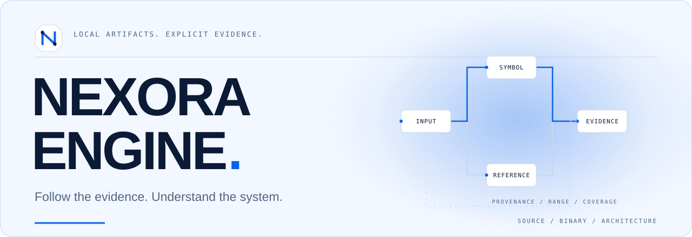
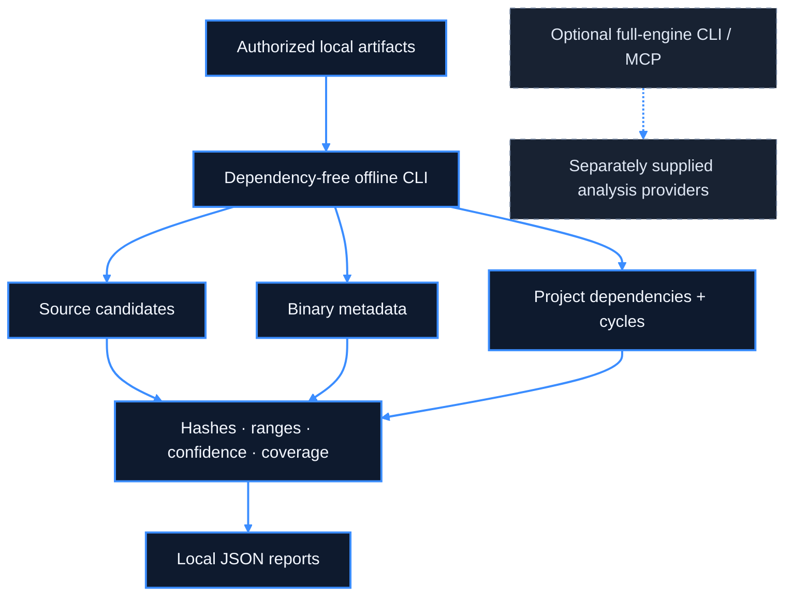
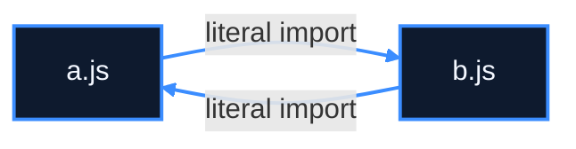

<picture>
  <source media="(max-width: 600px) and (prefers-color-scheme: dark)" srcset="assets/brand/hero-mobile-dark.svg">
  <source media="(max-width: 600px)" srcset="assets/brand/hero-mobile-light.svg">
  <source media="(prefers-color-scheme: dark)" srcset="assets/brand/hero-dark.svg">
  
</picture>

<h1 align="center">NEXORA ENGINE</h1>

<p align="center"><strong>Understand source, inspect binaries, and map architecture—with evidence you can trace.</strong></p>

<p align="center">
  <a href="#introduction"></a>
  <a href="LICENSE"></a>
  <a href="#first-run"></a>
</p>

<p align="center">
  <a href="#first-run">First run</a> ·
  <a href="#capabilities">Capabilities</a> ·
  <a href="docs/start-here.md">Documentation</a> ·
  <a href="#mcp-and-the-full-engine">MCP</a> ·
  <a href="docs/nexora-roadmap.md">Roadmap</a> ·
  <a href="CONTRIBUTING.md">Contribute</a>
</p>

## Introduction

NEXORA ENGINE helps developers inspect source code and executable artifacts, connect analysis evidence, and investigate software architecture. Choose the small offline CLI for local reports or build the provider-backed CLI/MCP engine for deeper workflows.

**Development source.** No official npm package, prebuilt release or hosted service is offered. Findings distinguish observations, static candidates and unknowns; a graph is not proof of runtime behavior.

## First run

First analysis in three commands, with Git and Node.js `24.22.1` available:

```sh
git clone https://github.com/NADER-CY/nexora-engine.git
cd nexora-engine
node nexora/bin/nexora.mjs analyze-project examples/tutorial/cycle
```

This dependency-free command needs no installation or build. The included two-file sample returns JSON with this actual selected result:

```json
{"architecture":{"schema":"nexora-architecture/v1","cycles":[{"members":["a.js","b.js"]}]}}
```

The full report also includes hashes, import evidence, coverage and limitations. [Understand the output](docs/tutorials/README.md) · [Captured demonstrations](docs/demos/README.md).

## Capabilities

| Workflow | Available scope | Important limit |
|:--|:--|:--|
| Source | Lexical function, call and dependency candidates for JS, TS, Go, Rust, C and C++ | Lexical results are not compiler semantics |
| Optional JS/TS AST | Scopes, binding evidence and direct relative ESM function-call candidates | Requires locked dependencies; not type checking, execution or general package resolution |
| Binary inspection | PE32/32+, ELF32/64 and thin Mach-O32/64 metadata, sections, symbols and references | No offline instruction disassembly or native CFG; format coverage varies |
| Binary evidence | PE relocations/CodeView/COFF names; bounded ELF REL/RELA entries | Relocation types remain raw; no loader emulation |
| Architecture | Dependency cycles and unified evidence graphs in JSON/Mermaid | Routes/events/config references are conservative static candidates |
| Ghidra interchange | JSONL function/pseudocode/reference import with optional input SHA-256 matching | Real exporter execution remains unverified here |
| Full engine | Shared CLI/MCP workflows and external provider adapters | Separate build, platform and provider prerequisites |

Inventories and output use bounded resources and report omissions. Cooperative limits do not isolate hostile files. [Current limitations](#security-and-limitations) · [Roadmap](docs/nexora-roadmap.md).

## Installation

| Path | Requirements | Guide |
|:--|:--|:--|
| Offline CLI | Git; supported Node.js | [First analysis](docs/tutorials/README.md) |
| Full CLI/MCP | Node.js, npm, locked dependencies and build; Windows x64 also needs its native addon | [Build from source](docs/installation/from-source.md) |
| Windows 10/11 | PowerShell; offline CLI needs no compiler | [Windows](docs/installation/windows.md) |
| Linux | Shell and supported Node.js; provider tools separately | [Linux](docs/installation/linux.md) |
| macOS | Shell and supported Node.js; provider tools separately | [macOS](docs/installation/macos.md) |

The repository pins **Node.js 24.22.1** and **npm 11.16.0**. Accepted Node ranges are `^22.23.4 || ^24.22.1 || >=26.12.1`; [package.json](package.json) is authoritative. Check `node --version` and `npm --version` before continuing. These guides do not install or upgrade system software.

<details>
<summary><strong>Full-engine build commands</strong></summary>

From the repository root, install the lockfile without lifecycle scripts:

```sh
npm ci --ignore-scripts
```

**On Windows x64**, first supply an existing MSYS2 UCRT64 or MINGW64 GCC toolchain. In PowerShell, replace the compiler directory if necessary:

```powershell
$env:NEXORA_MINGW_BIN = 'C:\msys64\ucrt64\bin'
npm run build:windows-native
npm run verify:windows-native:artifact
```

Then build and check the CLI (also the source-derived Linux/macOS build path):

```sh
npm run build
node scripts/nexora-engine.mjs --help
```

Windows dependency installation, native build/verification and full build passed on Node 24.22.1/npm 11.16.0. Linux/macOS installation and live desktop-client connections were not executed. Skipping lifecycle scripts may leave other optional native dependencies unavailable; review the affected provider rather than enabling all scripts. [Full verification scope](docs/github-experience-verification.md).

</details>

[Download source ZIP](https://github.com/NADER-CY/nexora-engine/archive/refs/heads/main.zip) if Git is unavailable; extract and enter the repository directory. [Updating an installation](docs/installation/updating.md).

## CLI workflows

Run from the repository root. Commands print JSON unless an explicit output format is selected.

```sh
node nexora/bin/nexora.mjs --help
node nexora/bin/nexora.mjs analyze-source examples/tutorial/project/main.js
node nexora/bin/nexora.mjs analyze-project examples/tutorial/project
node nexora/bin/nexora.mjs analyze-project examples/tutorial/cycle
```

With full dependencies installed, opt into JS/TS scope analysis:

```sh
node nexora/bin/nexora.mjs analyze-source-ast examples/tutorial/typescript/main.ts
node nexora/bin/nexora.mjs analyze-project-ast examples/tutorial/project
```

The lexical commands remain dependency-free. AST results retain unresolved dynamic, member, ambiguous and type-only relationships rather than inventing callees.

### Binary inspection and decompilation

Compile the included C sample using an already installed compiler; never execute it for these examples:

```sh
cc -g examples/tutorial/sample.c -o /tmp/nexora-example
node nexora/bin/nexora.mjs analyze-binary /tmp/nexora-example
```

Linux usually emits ELF and macOS Mach-O. Windows MinGW emits PE; the [Windows tutorial](docs/tutorials/README.md#pe-elf-and-mach-o) has PowerShell commands. The real MinGW PE example was inspected and compared with objdump. Other format variants are covered by synthetic fixtures, not a claim of real host compilation.

**Decompilation requires the full engine and a configured provider.** Inspect provider availability and diagnostics before analyzing a caller-selected binary:

```sh
node scripts/nexora-engine.mjs providers --json
node scripts/nexora-engine.mjs doctor --provider ghidra --json
```

After a compatible Ghidra/JDK is configured, the conditional workflow is `analyze <binary> --provider ghidra --json`, followed by `decompile <binary> <function-address> --provider ghidra --json`, using a function address from that analysis. These provider commands are source-verified; real Ghidra execution was not available in this check. [Provider requirements](docs/ghidra-provider.md).

### JSON and Mermaid architecture reports

```sh
node nexora/bin/nexora.mjs architecture-report examples/tutorial/cycle --out .nexora-reports/architecture.json
node nexora/bin/nexora.mjs architecture-report examples/tutorial/cycle --format mermaid --out .nexora-reports/architecture.mmd
```

These commands create the output directory. JSON retains evidence, confidence, hashes and coverage; Mermaid is a visual projection. The included dependency-cycle example can be explained as:



[Architecture contracts and advanced AST reports](docs/architecture/README.md). Route/event/configuration candidates do not establish live services, database boundaries or network schemas.

## Architecture overview



The offline layer is separate from the compiled provider-backed engine. Shared application workflows sit between CLI/MCP adapters and provider/domain contracts. Offline additions are not automatically MCP tools. [Detailed architecture](docs/architecture.mermaid).

## MCP and the full engine

After the full build, launch the stdio server:

```sh
node scripts/nexora-engine.mjs mcp
```

Waiting for protocol input is normal. Do not type shell commands into its stdin. Register an **absolute local Node path and launcher path**, avoiding unpublished package runners:

```sh
codex mcp add nexora-engine -- node /absolute/path/to/nexora-engine/scripts/nexora-engine.mjs mcp
claude mcp add --transport stdio nexora-engine -- node /absolute/path/to/nexora-engine/scripts/nexora-engine.mjs mcp
```

Replace the illustrative paths. These registration examples follow client documentation; they are not claims of a live Codex/Claude connection. [Codex](docs/mcp/codex.md) · [Claude Code/Desktop](docs/mcp/claude.md) · [Generic clients](docs/mcp/generic-client.md) · [MCP verification stages](docs/mcp/README.md).

## Ghidra interchange

Bring your own compatible Ghidra distribution and full JDK. Set `GHIDRA_INSTALL_DIR` and `JAVA_HOME` to your local installations for provider workflows. The provider's checked release contract and Java requirements are described in [Ghidra setup](docs/tutorials/ghidra.md); nothing installs Ghidra or Java automatically.

```sh
node nexora/bin/nexora.mjs ghidra-report examples/tutorial/ghidra.synthetic.jsonl
```

That sample is **synthetic**, not decompiler proof. For your own real export, use `ghidra-report /absolute/export.jsonl --binary /absolute/original-binary` to check its reported SHA-256 against the local binary. A mismatch is rejected; interrupted/missing-footer exports remain incomplete. [Headless export walkthrough](docs/tutorials/ghidra.md).

## Documentation

| Goal | Start here |
|:--|:--|
| Install and update | [Overview](docs/installation/from-source.md), [Windows](docs/installation/windows.md), [Linux](docs/installation/linux.md), [macOS](docs/installation/macos.md), [updates](docs/installation/updating.md) |
| First analysis | [Tutorials](docs/tutorials/README.md), [samples](examples/tutorial/README.md), [actual outputs](docs/demos/README.md) |
| Connect an agent | [MCP overview](docs/mcp/README.md), [Codex](docs/mcp/codex.md), [Claude](docs/mcp/claude.md) |
| Understand evidence | [Architecture](docs/architecture/README.md), [Ghidra](docs/tutorials/ghidra.md), [limitations](#security-and-limitations) |
| Resolve a problem | [Troubleshooting and FAQ](docs/troubleshooting.md), [verification record](docs/github-experience-verification.md) |
| Contribute | [Contributor guide](CONTRIBUTING.md), [roadmap](docs/nexora-roadmap.md), [changelog](CHANGELOG.md) |

<details>
<summary><strong>Troubleshooting and frequently asked questions</strong></summary>

- **Do I need dependencies for first run?** No. Lexical source, binary and dependency reports use Node built-ins. AST commands and the full engine require dependencies.
- **Missing compiled runtime?** Follow the full source-build guide; on Windows build and verify the native addon first.
- **Unsupported Node version?** Resolve the intended executable on PATH and use a version accepted by package.json.
- **Missing optional parser?** Install locked dependencies with `npm ci --ignore-scripts`; use lexical analysis if the AST parser is unavailable.
- **Is a static edge a runtime call?** No. Read the evidence method, confidence, unresolved fields and coverage.
- **Why is MCP waiting?** Stdio waits for a client's JSON-RPC initialization. Validate process startup, initialization, tool discovery, invocation and shutdown separately.
- **Where is the installer/npm package?** This is a source distribution; no official registry installation is offered.
- **Can reports be shared?** They may contain proprietary source, paths and pseudocode. Review and sanitize them first.

</details>

## Security and limitations

Analyze only artifacts you are authorized to inspect. Reports can disclose source, symbols, paths, configuration references and decompiled material. Keep them private unless intentionally sanitized. Isolate hostile inputs; cooperative parser budgets are not hard OS containment. Providers may launch external tools or access caller-selected resources, depending on the requested workflow.

Real Ghidra execution, Linux/macOS installation, live Codex/Claude connections, native instruction-level CFGs and deep Go/Rust/C/C++ compiler semantics remain unverified or unfinished. AST analysis is conservative static evidence, not runtime proof or a type checker. There are no performance or production-readiness claims.

[Security policy](SECURITY.md) · [Disclaimer](DISCLAIMER.md) · [Public-source review](PUBLICATION_REVIEW.md). npm remains private; automatic publishing/deployment workflows remain disabled.

## Roadmap and contributing

The next development focus is deeper reverse-engineering capability: verified Ghidra exports, native disassembly/CFG evidence, stronger compiler semantics and resource/lifecycle regressions. [Roadmap](docs/nexora-roadmap.md).

Contribute minimal reproductions, parser regressions, provider verification and clearer uncertainty reporting. Read [CONTRIBUTING.md](CONTRIBUTING.md) and the [code of conduct](CODE_OF_CONDUCT.md); report actual results and missing tools honestly. [Open an issue](https://github.com/NADER-CY/nexora-engine/issues/new/choose).

## Origin & License

NEXORA ENGINE is an independently maintained, MIT-licensed open-source reverse-engineering platform, developed and expanded from the **REA** codebase by **morluto**, with its own features, improvements, branding and roadmap. Inherited code is not claimed as independently authored. This project is not affiliated with or endorsed by its upstream authors.

The MIT License and **Copyright (c) 2026 morluto** are preserved. [LICENSE](LICENSE) · [NOTICE](NOTICE.md) · [Third-party notices](THIRD_PARTY_NOTICES.md).
